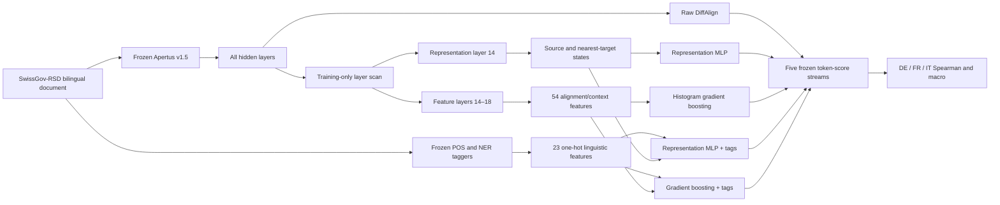

# Architecture



## Leakage boundary

```text
SwissGov development split (504 document pairs)
  ├── 453 training documents
  │     ├── layer selection
  │     └── lightweight-model fitting
  └── 51 validation documents (17 per language)
        ├── MLP early stopping
        └── development diagnostics

SwissGov test split (168 document pairs)
  └── frozen evaluation after all choices are fixed
```

Layer selection uses only the training documents. The test split is never read
by the scanner or training commands. POS/NER schemas are fixed constants, and
punctuation is identified from observable input tokens and POS predictions.

## Scaling ablation

The diagram describes the primary 8B system (representation layer 14 and
feature layers 14–18). The frozen 70B ablation uses the same graph and data
boundary, with representation layer 17 and feature layers 17, 19, 18, 16, and
20 selected exclusively from development data. It is evaluated as a separate
system; no test-tuned 8B/70B ensemble is constructed.

