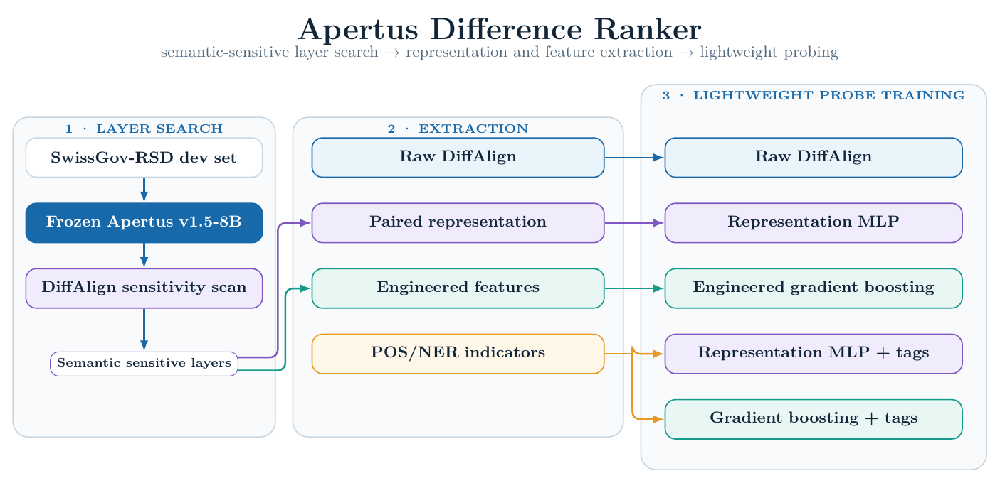
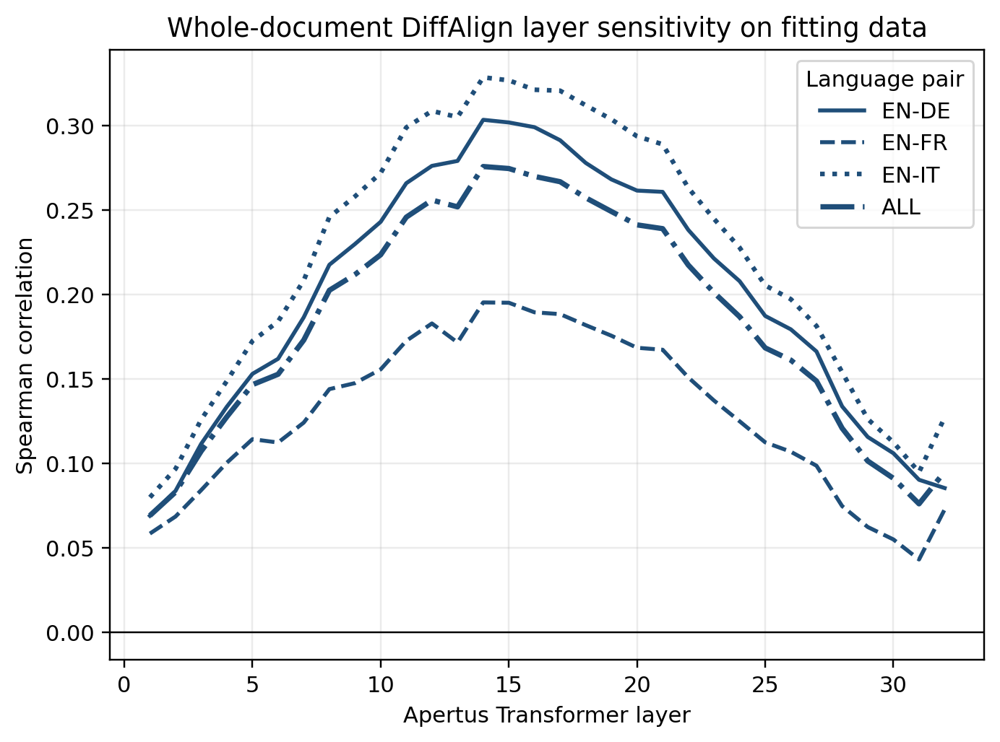

# Technical report — Apertus Difference Ranker

- **Track:** Track 2A — UZH: Detecting Cross-Lingual Semantic Differences in Swiss Government Websites
- **Event:** Online
- **Team:** Chenfei Wen (individual participant)
- **Demo:** Reproducible Docker result replay via `make run`

## 1. Summary

Related Swiss government pages can diverge because of translation mistakes or
asynchronous updates. We built a token-level cross-lingual semantic-difference
ranker around frozen Apertus v1.5 representations. The pipeline performs
bidirectional whole-document DiffAlign, selects semantic-sensitive layers using
development-training documents, and compares four lightweight supervised
models. On the untouched 168-document test split, the best system—histogram
gradient boosting over five layers of alignment features plus POS/NER—reaches
**0.3275 macro Spearman**. Raw DiffAlign reaches **0.2632**, so the final model
improves it by **0.0643 absolute** (24.4% relative). A complete, identically
controlled 70B ablation improves raw DiffAlign to 0.2737 but reaches only
0.3168 with its best lightweight head; scaling therefore does not replace the
more efficient 8B primary system.

## 2. Architecture



Figure 1. End-to-end training and evaluation paradigm. All layer selection,
feature design, fitting, early stopping, and model choice use only the official
development split; the test split is reserved for final evaluation.

The pipeline has five stages:

1. **Frozen extraction.** Each side of a bilingual document pair is encoded
   independently with Apertus. SwissGov whitespace words are mapped to one or
   more Apertus subwords and pooled back to the benchmark tokenization.
2. **Layer scan.** Evaluate DiffAlign at every layer on the 453-document fitting
   partition. Use the best layer for paired representations and the top five
   for engineered features, without using validation or test data.
3. **Feature construction.** The paired-state branch uses raw source and nearest
   target states. The engineered branch summarizes each token's cross-document
   cosine row and its local context. Optional POS/NER one-hot features are
   concatenated to either branch.
4. **Lightweight fitting.** Two representation MLPs and two histogram gradient
   boosters are trained while every Apertus parameter remains frozen.
5. **Frozen evaluation.** Selected layers, tag vocabularies, and fitted weights
   are applied to all 168 test documents without adaptation.

The data flow and leakage boundary are shown in
[`docs/ARCHITECTURE.md`](docs/ARCHITECTURE.md).

### 2.1 Raw DiffAlign

For each source subword, DiffAlign finds the maximum cosine similarity to any
subword in the counterpart document and converts it to a continuous difference
score. Scores are averaged over the Apertus subwords belonging to each
SwissGov word. The computation is repeated in both language directions.

### 2.2 Paired-representation MLP

At selected layer 14, each source word is paired with its cosine-nearest target
word. For hidden size `d=4096`, the MLP input is:

```text
[source_d, target_d, abs(source_d-target_d), source_d*target_d]
```

The untagged width is `4d = 16,384`; the linguistic version appends 23 columns.
The head is:

```text
LayerNorm(input) → Linear(input, 128) → GELU → Dropout(0.1)
→ Linear(128, 1) → Sigmoid
```

The untagged head has 2,130,177 trainable parameters; Apertus has none.
MLPs train for at most 20 epochs. Validation macro Spearman is checked after
every epoch, the best state is retained, and training stops after five
consecutive non-improving epochs.

### 2.3 Engineered gradient boosting

For each of selected layers 14–18, eight features are computed:

1. top-1 cosine distance;
2. mean top-5 cosine distance;
3. top-1/top-2 margin;
4. normalized alignment entropy;
5. cosine-row mean;
6. cosine-row standard deviation;
7. mutual-nearest-neighbour indicator;
8. source hidden-state norm.

Previous- and next-token top-1 distances add ten local-context values across
five layers. Four static values encode subword count, relative position, log
character length, and document side. The untagged vector therefore has
`5×8 + 5×2 + 4 = 54` features.

The regressor is `HistGradientBoostingRegressor` with 300 iterations, learning
rate 0.05, at most 31 leaf nodes, L2 regularization 1.0, and seed 42. It uses all
300 iterations; validation is diagnostic rather than an early-stopping signal.

### 2.4 Linguistic features

The tagged variants append 23 fixed-width one-hot columns:

- six NER categories: `O`, `PER`, `ORG`, `LOC`, `MISC`, `PUNCT`;
- seventeen Universal POS categories.

NER comes from `Davlan/xlm-roberta-base-ner-hrl`; POS comes from
`wietsedv/xlm-roberta-base-ft-udpos28-en`. These auxiliary models do not supply
semantic embeddings or alignment scores. They run as frozen taggers, are
unloaded before Apertus extraction, and contribute only token-class labels.
Punctuation is detected from observable token/POS information, never from test
gold labels.

### 2.5 Objective and imbalance

Punctuation (`gold = -1`) is excluded. In MLP training, tokens with positive
semantic difference receive total weight 5 versus weight 1 for zero-difference
tokens. The loss is weighted Smooth-L1 plus a pairwise logistic ranking term
with weight 0.2 and temperature 0.1. Gradient boosting uses the same sample
weights.

## 3. Use of Apertus

- **Model:** `swiss-ai/Apertus-v1.5-8B`
- **Role:** frozen local representation extraction and all semantic alignment features
- **Execution:** local weights on CSCS Clariden GPU nodes
- **Selected layers:** representation layer 14; engineered layers 14–18
- **Test passes:** 336 for 168 documents, one pass per document side
- **Transformers implementation:** Swiss AI fork at commit `3797303dda74844e3d1f8977ff5518bb91f818b4`

No non-Apertus embedding model contributes to the semantic comparison. The two
auxiliary XLM-R models provide only coarse POS and NER categories as disclosed
above. No Apertus parameter is updated.

For the controlled 70B ablation, Apertus also remains frozen. Development-only
selection chooses representation layer 17 and engineered layers 17, 19, 18,
16, and 20. The architecture, training split, objectives, linguistic taggers,
and test-isolation procedure are otherwise unchanged.

## 4. Data

We use
[`ZurichNLP/SwissGov-RSD`](https://huggingface.co/datasets/ZurichNLP/SwissGov-RSD),
a CC BY 4.0 benchmark of multilingual Swiss government document pairs with
token-level semantic-difference labels. Hugging Face exposes 504 development
pairs and 168 test pairs for the evaluated English–German, English–French, and
English–Italian directions.

Using seed 42, the 504 development pairs are divided by document and language:

- 453 fitting documents;
- 51 validation documents, exactly 17 per language pair.

The test split is excluded from layer selection, fitting, early stopping, and
feature design. Dataset records and model weights remain in their original
repositories and are not committed. No additional personal data is collected.

## 5. Evaluation

The primary metric is token-level Spearman correlation for EN–DE, EN–FR, and
EN–IT. We report each direction, their unweighted macro average, and the pooled
correlation over all scored tokens. Punctuation is excluded.

### 5.1 Layer sensitivity

DiffAlign is first evaluated at every Apertus layer on the 453-document fitting
partition. Layer selection uses only this partition; the 51-document validation
scores below are diagnostics. Both backbones place their strongest raw
cross-lingual signal in an early-to-middle band rather than at the final layer.

| Backbone | Representation layer | Fitting macro | Validation macro | Engineered-feature layers |
|---|---:|---:|---:|---|
| Apertus-v1.5-8B | 14 | 0.2759 | 0.2411 | 14, 15, 16, 17, 18 |
| Apertus-v1.5-70B | 17 | 0.2855 | 0.2450 | 17, 19, 18, 16, 20 |

For 8B, layer 14 is best on both the fitting and validation partitions. For
70B, fitting selects layer 17; the diagnostic validation maximum occurs at
layer 16 with 0.2477, only 0.0027 above layer 17. The fitting-only selection is
retained to preserve the experimental boundary.



Figure 2. Whole-document DiffAlign Spearman across Apertus-v1.5-8B layers on
the fitting partition. Line styles distinguish EN–DE, EN–FR, EN–IT, and ALL;
ALL is their unweighted macro average and determines layer selection. The corresponding
[70B layer-sensitivity curve](docs/layer_spearman_70b.png) is included with the
submission.

### 5.2 8B development diagnostic and frozen test results

| Setup | Full-dev macro | Test DE | Test FR | Test IT | Test macro | Change vs. raw | Test pooled |
|---|---:|---:|---:|---:|---:|---:|---:|
| Raw Apertus DiffAlign | 0.2730 | 0.2934 | 0.1612 | 0.3350 | 0.2632 | — | 0.2672 |
| Representation MLP | **0.4578** | 0.3413 | 0.2177 | 0.3685 | 0.3092 | +0.0460 | 0.3199 |
| Engineered gradient boosting | 0.3686 | 0.3678 | 0.2118 | 0.3944 | 0.3247 | +0.0614 | 0.3296 |
| Representation MLP + POS/NER | 0.3741 | 0.3621 | **0.2188** | 0.3762 | 0.3190 | +0.0558 | 0.3250 |
| Engineered gradient boosting + POS/NER | 0.3715 | **0.3705** | 0.2158 | **0.3961** | **0.3275** | **+0.0643** | **0.3325** |

The full-development column is diagnostic: it evaluates all 504 development
documents, including the 453 documents used to fit the probes. It is therefore
not a held-out generalization estimate. The frozen test columns remain the
primary results.

All 168 test documents complete successfully, covering 40,689 German, 46,623
French, and 44,768 Italian tokens (132,080 total). The best system improves raw
DiffAlign in every language: +0.0771 for German, +0.0546 for French, and
+0.0611 for Italian. Its macro gain is 0.0643 absolute, or 24.4% relative.
Engineered features outperform paired raw states in both tagged and untagged
comparisons. POS/NER adds 0.0098 to the representation MLP and 0.0028 to the
booster on test, although the validation results show that these gains are not
uniformly stable. French remains the most difficult direction.

### 5.3 70B development diagnostic and controlled scaling ablation

The full Apertus-v1.5-70B dependency chain also completes all 168 test
documents and 132,080 scored tokens without failure.

| 70B setup | Full-dev macro | Test DE | Test FR | Test IT | Test macro | Change vs. raw | Test pooled |
|---|---:|---:|---:|---:|---:|---:|---:|
| Raw Apertus DiffAlign | 0.2821 | 0.3048 | 0.1687 | 0.3476 | 0.2737 | — | 0.2786 |
| Representation MLP | 0.3814 | 0.3588 | 0.2178 | 0.3646 | 0.3137 | +0.0400 | 0.3201 |
| Engineered gradient boosting | 0.3778 | 0.3674 | 0.1996 | 0.3804 | 0.3158 | +0.0421 | 0.3204 |
| Representation MLP + POS/NER | **0.4003** | 0.3555 | **0.2253** | 0.3698 | **0.3168** | **+0.0431** | **0.3244** |
| Engineered gradient boosting + POS/NER | 0.3790 | **0.3677** | 0.2007 | **0.3812** | 0.3165 | +0.0428 | 0.3213 |

As in the 8B table, the full-development scores are diagnostic because they
include the documents used to fit the probes; the frozen test scores provide
the controlled generalization comparison.

Relative to 8B, 70B raises raw DiffAlign by 0.0105 macro and the plain
representation MLP by 0.0045. It does not improve either engineered booster or
the best final score: the strongest 70B head remains 0.0106 below the 8B
primary system. Increased backbone capacity therefore modestly improves raw
cross-lingual geometry but does not automatically improve a lightweight probe
fitted on the same limited data. No post-hoc 8B/70B ensemble is formed.

### 5.4 Protocol checks

The frozen result artifacts record
`test_data_used_for_training_or_selection=false`, zero failed documents, and
the same token counts for every method. The Docker replay checks the method
set, document and token counts, and recomputed macro averages. Predictions on
the complete development split are retained only as diagnostics because 453 of
its 504 documents are also used to fit the probes; they are not presented as
generalization estimates. The exact frozen aggregates are included as
[`final_test_8b_summary.json`](data/results/final_test_8b_summary.json) and
[`final_test_70b_summary.json`](data/results/final_test_70b_summary.json).

### 5.5 Prompted baseline audit

During development we attempted the paper-style prompted token-label format. On
50 German development examples, Apertus-8B produced only one structurally valid
side out of 100; the rest had label-count or structured-output violations. Its
nominal correlation is not treated as a valid baseline. Raw frozen-Apertus
DiffAlign is the complete-coverage baseline reported above.

## 6. Limitations

- Macro Spearman 0.3275 remains well below perfect token ranking.
- French performance is substantially lower than German and Italian.
- Whole-document nearest neighbours can select repeated or generic words and
  do not enforce monotonic alignment.
- Engineered features may capture benchmark-specific regularities.
- The 51-document validation set serves both early stopping and development
  comparison, making its scores optimistic; the frozen test result mitigates
  this but does not provide multi-seed uncertainty.
- POS and NER depend on auxiliary taggers whose errors can propagate.
- The gated Apertus weights cannot be redistributed, and full reproduction
  requires CSCS-class GPU resources.
- The prompted baseline was structurally invalid and is not directly
  comparable to the submitted complete-coverage systems.
- The 70B scaling conclusion is based on one frozen training seed for each
  model size; multi-seed uncertainty remains unmeasured.

## 7. Reproducibility

Run the frozen result replay:

```bash
make run
```

Complete Clariden setup, job commands, output paths, model revision, and
integrity checks are documented in [`docs/REPRODUCE.md`](docs/REPRODUCE.md).
Layer scans save train, validation, and all-development Spearman for every
layer as CSV plus a PNG plot.

Key controls:

- random seed: 42;
- development partition: 453 train / 51 validation documents;
- test documents successfully processed: 168/168;
- test used for development: false;
- Apertus frozen: true;
- model passes in final test evaluation: 336.

## 8. Next steps

1. **Improve French robustness.** French remains the weakest language pair, so
   future experiments should use language-balanced batches, language-specific
   error analysis, and multiple random seeds to determine whether the gap comes
   from data composition, representation quality, or probe instability.
2. **Constrain cross-document alignment.** Nearest-neighbour DiffAlign can match
   repeated or generic words anywhere in the counterpart document. Monotonic,
   optimal-transport, or document-structure constraints could reduce these
   false matches while preserving a score for every token.
3. **Strengthen feature learning.** The current POS and NER tags provide only
   small improvements. A useful extension is to compare them with linguistic
   attributes predicted directly from Apertus and to learn how evidence from
   several semantic-sensitive layers should be combined.
4. **Evaluate stronger lightweight heads.** Multi-seed experiments with
   calibrated ensembles, pairwise ranking losses, and language-aware probes
   could test whether the remaining performance gap can be reduced without
   fine-tuning the Apertus backbone.
5. **Establish a valid prompted baseline.** The exploratory prompted system
   frequently violated the required token-label structure. Constrained decoding
   or exact schema enforcement would enable a complete-coverage comparison with
   the representation-based systems.

## License

Documentation: Creative Commons Attribution 4.0. Code: Apache License 2.0 via
the repository-level `LICENSE`.

## References

HackApertus. 2026. *Hack Apertus project template*. GitHub repository.
[https://github.com/HackApertus/project-template](https://github.com/HackApertus/project-template).

Swiss AI. 2026a. *Apertus-v1.5-8B*. Hugging Face model repository.
[https://huggingface.co/swiss-ai/Apertus-v1.5-8B](https://huggingface.co/swiss-ai/Apertus-v1.5-8B).

Swiss AI. 2026b. *Apertus-v1.5-70B*. Hugging Face model repository.
[https://huggingface.co/swiss-ai/Apertus-v1.5-70B](https://huggingface.co/swiss-ai/Apertus-v1.5-70B).

Michelle Wastl, Jannis Vamvas, and Rico Sennrich. 2026. SwissGov-RSD: A
human-annotated, cross-lingual benchmark for token-level recognition of
semantic differences between related documents. In *Proceedings of the 64th
Annual Meeting of the Association for Computational Linguistics (Volume 1:
Long Papers)*, pages 31134–31163, San Diego, California, United States.
Association for Computational Linguistics.
[https://aclanthology.org/2026.acl-long.1437/](https://aclanthology.org/2026.acl-long.1437/).

ZurichNLP. 2026. *SwissGov-RSD*. Hugging Face dataset repository.
[https://huggingface.co/datasets/ZurichNLP/SwissGov-RSD](https://huggingface.co/datasets/ZurichNLP/SwissGov-RSD).

